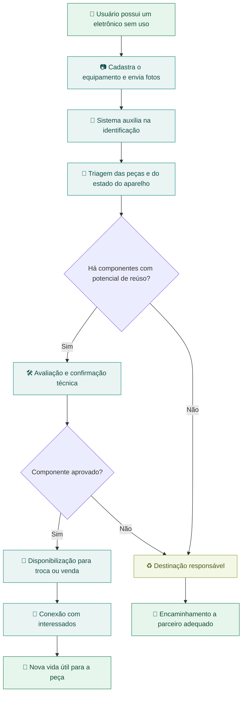
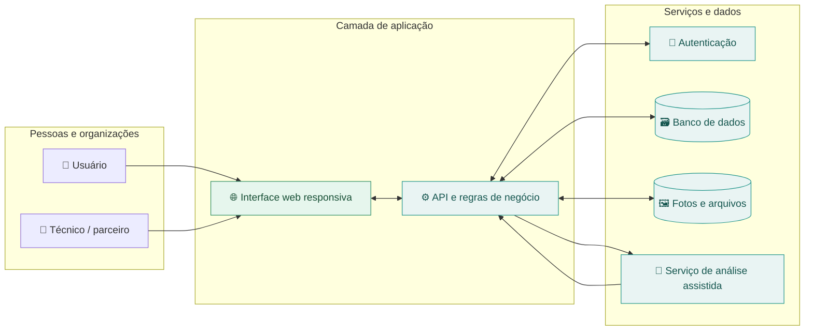
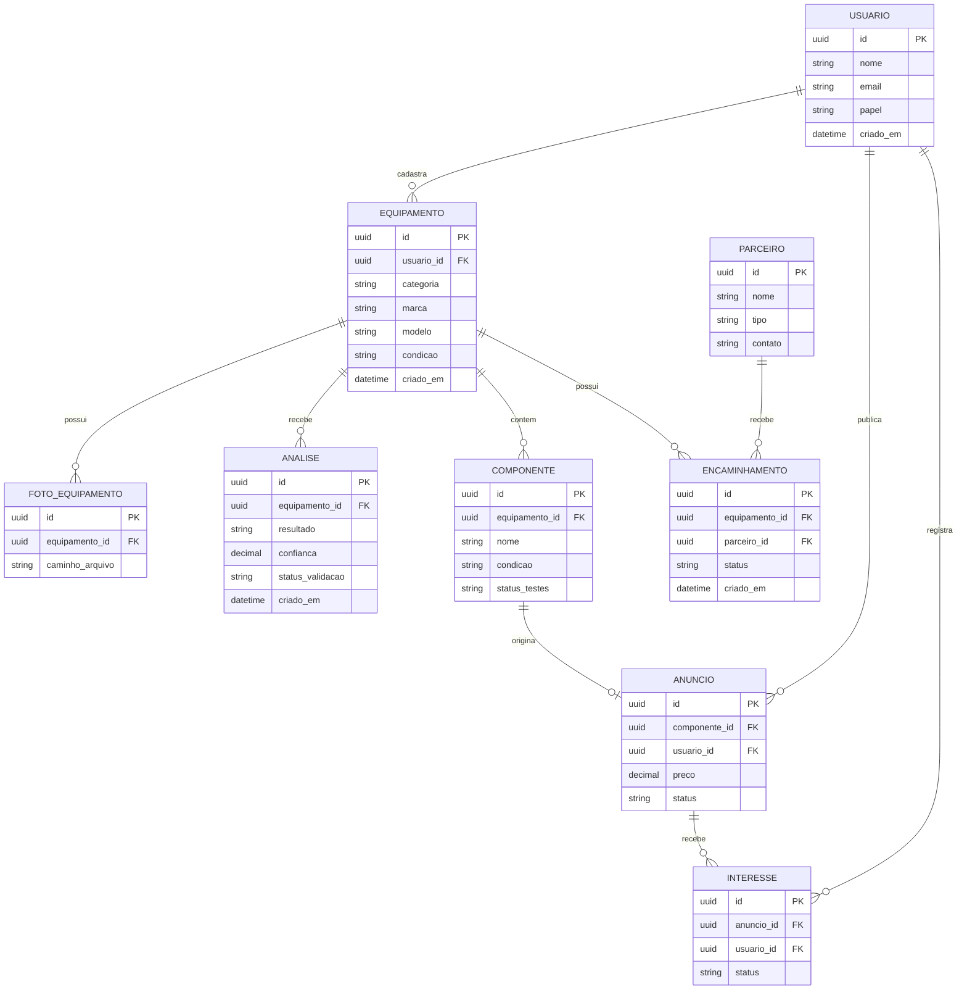

<!--
  EcoCiclo • README do projeto
  Os fluxos e modelos abaixo documentam a proposta da plataforma.
  Eles não representam funcionalidades já implementadas neste repositório.
-->

<div align="center">

# ♻️ EcoCiclo

### Tecnologia que conecta reutilização, recuperação e economia circular.

**Uma plataforma para dar uma nova oportunidade a equipamentos e componentes eletrônicos.**

[](#-status-do-projeto)
[](#-impacto-que-buscamos)
[](#-sobre-o-ecociclo)

**[Visão geral](#-sobre-o-ecociclo) · [Como funciona](#-como-funciona) · [Arquitetura](#-arquitetura-proposta) · [Modelo de dados](#-modelo-de-dados-conceitual) · [Roadmap](#-roadmap)**

</div>

---

## 🌎 Sobre o EcoCiclo

Um computador que parou de funcionar nem sempre virou lixo. Muitas vezes, a memória, o armazenamento, a fonte ou outras peças ainda podem ser utilizadas em reparos e novos projetos.

O **EcoCiclo** nasce para reduzir a distância entre **quem tem equipamentos eletrônicos parados** e **quem pode aproveitar seus componentes**.

A proposta é desenvolver uma plataforma web em que pessoas e organizações possam cadastrar aparelhos, receber auxílio na identificação de peças potencialmente reaproveitáveis e conectá-las a técnicos, estudantes, oficinas, compradores e parceiros de reciclagem.

> **Nossa ideia é simples:** antes de descartar um eletrônico, descobrir o que ainda pode ter valor e garantir um destino responsável para o restante.

### 🎯 O problema que queremos resolver

- **Desperdício:** equipamentos inteiros são descartados mesmo quando parte de seus componentes ainda funciona.
- **Falta de informação:** muitas pessoas não sabem o que pode ser recuperado nem como avaliar uma peça.
- **Dificuldade de conexão:** quem tem peças sobrando nem sempre encontra quem precisa delas.
- **Impacto ambiental:** o descarte inadequado de resíduos eletrônicos pode contaminar o ambiente e desperdiçar recursos.

### 💡 Nossa proposta

| Etapa | O que o EcoCiclo pretende oferecer | Valor gerado |
|:--|:--|:--|
| 📷 **Cadastrar** | Registro de equipamentos, fotos e informações sobre seu estado | Inventário de itens disponíveis |
| 🧠 **Analisar** | Apoio de IA na identificação de aparelhos e possíveis componentes | Orientação inicial para triagem |
| 🔧 **Recuperar** | Indicação de peças que merecem avaliação técnica | Incentivo ao reparo e reúso |
| 🤝 **Conectar** | Divulgação de componentes para interessados | Circulação de peças utilizáveis |
| 🌱 **Destinar** | Encaminhamento do que não pode ser aproveitado a parceiros adequados | Redução do descarte incorreto |

---

## 🔄 Como funciona

O fluxo abaixo descreve a **experiência planejada** para o usuário, do cadastro à destinação.



> A **IA funciona como apoio**, não como certificação. A identificação automática pode apresentar erros; segurança, funcionalidade e possibilidade de revenda exigem verificação apropriada.

---

## ✨ Funcionalidades previstas

| Módulo | Descrição | Situação |
|:--|:--|:--:|
| **Contas e perfis** | Cadastro e acesso de usuários, técnicos e parceiros | 📋 Planejado |
| **Inventário de eletrônicos** | Cadastro de equipamentos, fotos e características | 📋 Planejado |
| **Triagem assistida por IA** | Identificação preliminar e sugestões de aproveitamento | 📋 Planejado |
| **Catálogo de componentes** | Busca e filtros por tipo, condição e compatibilidade | 📋 Planejado |
| **Anúncios** | Divulgação de peças recuperadas para interessados | 📋 Planejado |
| **Destinação responsável** | Informações e integração futura com parceiros de reciclagem | 📋 Planejado |
| **Painel de impacto** | Indicadores de itens recuperados e encaminhados | 📋 Planejado |

A implementação será realizada por etapas. A tabela representa o **escopo pretendido**, não uma lista de recursos disponíveis hoje.

---

## 🧩 Arquitetura proposta

A arquitetura abaixo é uma **referência conceitual**, independente de frameworks específicos. As ferramentas definitivas serão escolhidas durante o desenvolvimento.



### Princípios de implementação

1. **Mobile first:** cadastrar e fotografar equipamentos deve ser fácil pelo celular.
2. **Acessibilidade:** navegação por teclado, contraste adequado e feedback claro.
3. **Privacidade:** coletar apenas os dados necessários e protegê-los adequadamente.
4. **Rastreabilidade:** registrar a origem, a avaliação e o destino de cada item quando aplicável.
5. **IA responsável:** deixar explícito quando uma informação é estimada, sugerida ou confirmada por um profissional.
6. **Evolução modular:** começar pelo cadastro e catálogo, avançando para análises e integrações.

---

## 🗄️ Modelo de dados conceitual

Este diagrama ER representa uma **proposta inicial de entidades e relacionamentos**. Não é o esquema de um banco já criado.



**Como ler o diagrama:** `PK` identifica a chave primária; `FK` identifica a chave estrangeira. As relações indicam, por exemplo, que um usuário pode cadastrar vários equipamentos, enquanto cada componente pertence a um equipamento.

A estrutura poderá ser ajustada conforme decisões de produto, requisitos de segurança e necessidades reais dos usuários.

---

## 🤖 Exemplo ilustrativo de análise por IA

A ideia é transformar fotos e informações de um aparelho em uma **triagem compreensível**, indicando o que merece inspeção.

**Entrada:** um usuário cadastra um computador que não liga e envia imagens.

**Saída proposta** (dados fictícios, apenas para demonstrar o formato):

```json
{
  "equipamento": {
    "categoria": "computador_desktop",
    "estado_informado": "nao_liga"
  },
  "analise": {
    "status": "preliminar",
    "componentes_sugeridos": [
      {
        "nome": "memoria_ram",
        "acao": "realizar_teste_de_funcionamento"
      },
      {
        "nome": "unidade_de_armazenamento",
        "acao": "avaliar_integridade_e_apagar_dados"
      },
      {
        "nome": "fonte_de_alimentacao",
        "acao": "encaminhar_para_avaliacao_tecnica"
      }
    ],
    "observacao": "Nenhum componente foi certificado como funcional."
  }
}
```

A resposta não deve afirmar que uma peça funciona sem testes. Também é importante orientar o usuário a não abrir equipamentos com risco elétrico e a **remover dados pessoais** de dispositivos de armazenamento antes de qualquer transferência.

---

## 👥 Para quem é o EcoCiclo?

| Público | Possível benefício |
|:--|:--|
| 🏠 **Moradores** | Encontrar alternativas ao descarte de eletrônicos parados |
| 🔧 **Técnicos e oficinas** | Encontrar peças para manutenção e recuperação |
| 🎓 **Estudantes** | Acessar componentes para aprendizado e projetos |
| 🏪 **Pequenos empreendedores** | Comprar, vender ou reaproveitar peças |
| 🏭 **Recicladores e parceiros** | Receber encaminhamentos de itens não recuperáveis |
| 🏙️ **Municípios** | Incentivar práticas de destinação adequada e economia circular |

---

## 🌱 Impacto que buscamos

O EcoCiclo está alinhado à ideia de **economia circular**: manter produtos e materiais em uso pelo maior tempo possível, reduzir desperdício e melhorar o destino dos resíduos.


### Indicadores que queremos acompanhar

- **Equipamentos cadastrados** na plataforma.
- **Componentes avaliados e recuperados**, após validação.
- **Peças disponibilizadas e reaproveitadas** por outros usuários.
- **Itens encaminhados** para destinação adequada.
- **Estimativas ambientais**, futuramente, com metodologia e fontes claramente identificadas.

> Os indicadores são metas de mensuração. **Não há resultados ambientais medidos ou validados publicados neste repositório até o momento.**

---

## 🗺️ Roadmap

- [ ] **Fase 1 · Fundação:** definir experiência do usuário, identidade visual e estrutura inicial do sistema.
- [ ] **Fase 2 · Cadastro:** autenticação, perfis e registro de equipamentos com fotografias.
- [ ] **Fase 3 · Catálogo:** cadastro de componentes, filtros e anúncios.
- [ ] **Fase 4 · Inteligência:** implementar triagem assistida com validação técnica.
- [ ] **Fase 5 · Conexões:** facilitar contato entre interessados e parceiros.
- [ ] **Fase 6 · Impacto:** criar painel com métricas confiáveis de reaproveitamento e destinação.
- [ ] **Fase 7 · Evolução:** testar com usuários, aprimorar acessibilidade, segurança e desempenho.

A ordem pode mudar conforme a validação do projeto e as prioridades de desenvolvimento.

---

## 🚧 Status do projeto

**Em planejamento / documentação inicial.**

Atualmente, este repositório contém a apresentação do projeto. A documentação de fluxos, dados e arquitetura mostra **como pretendemos construir** o EcoCiclo; ela não significa que a interface, a API, o banco de dados ou a IA já estejam implementados.

Quando houver código publicado, esta seção será atualizada com tecnologias utilizadas, requisitos, instalação local, variáveis de ambiente **sem valores secretos** e instruções de execução/deploy.

### 🤝 Como colaborar

Ideias sobre reaproveitamento, experiência de uso, acessibilidade, triagem e destinação de resíduos são bem-vindas. Você pode propor melhorias por meio das [issues do repositório](https://github.com/piririporo/EcoCiclo/issues), quando habilitadas.

---

<div align="center">

### ♻️ EcoCiclo

**Menos descarte. Mais possibilidades.**

*Porque o fim de um equipamento não precisa ser o fim de todos os seus componentes.*

[⬆️ Voltar ao início](#️-ecociclo)

</div>
