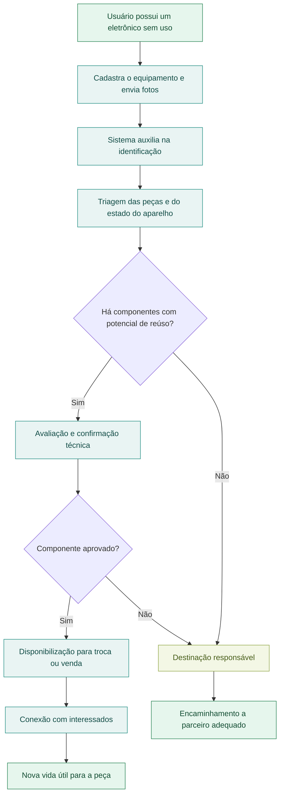
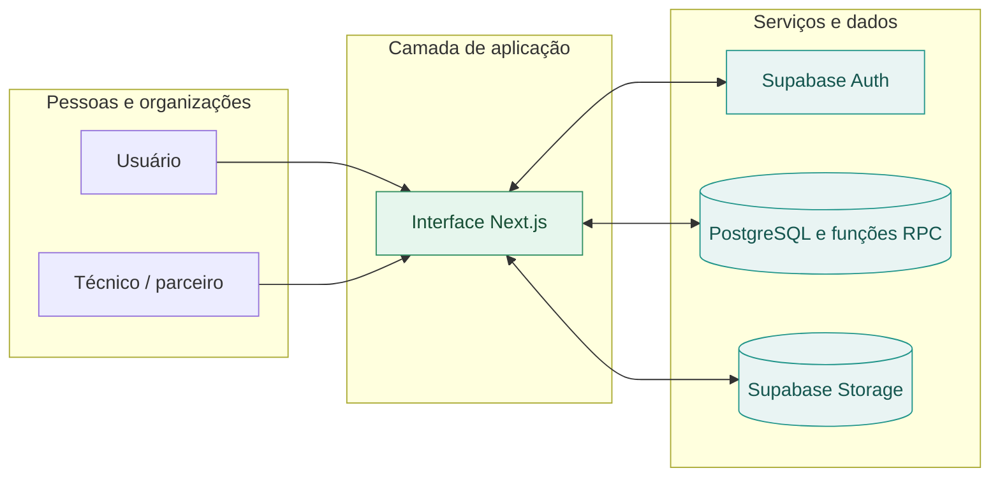
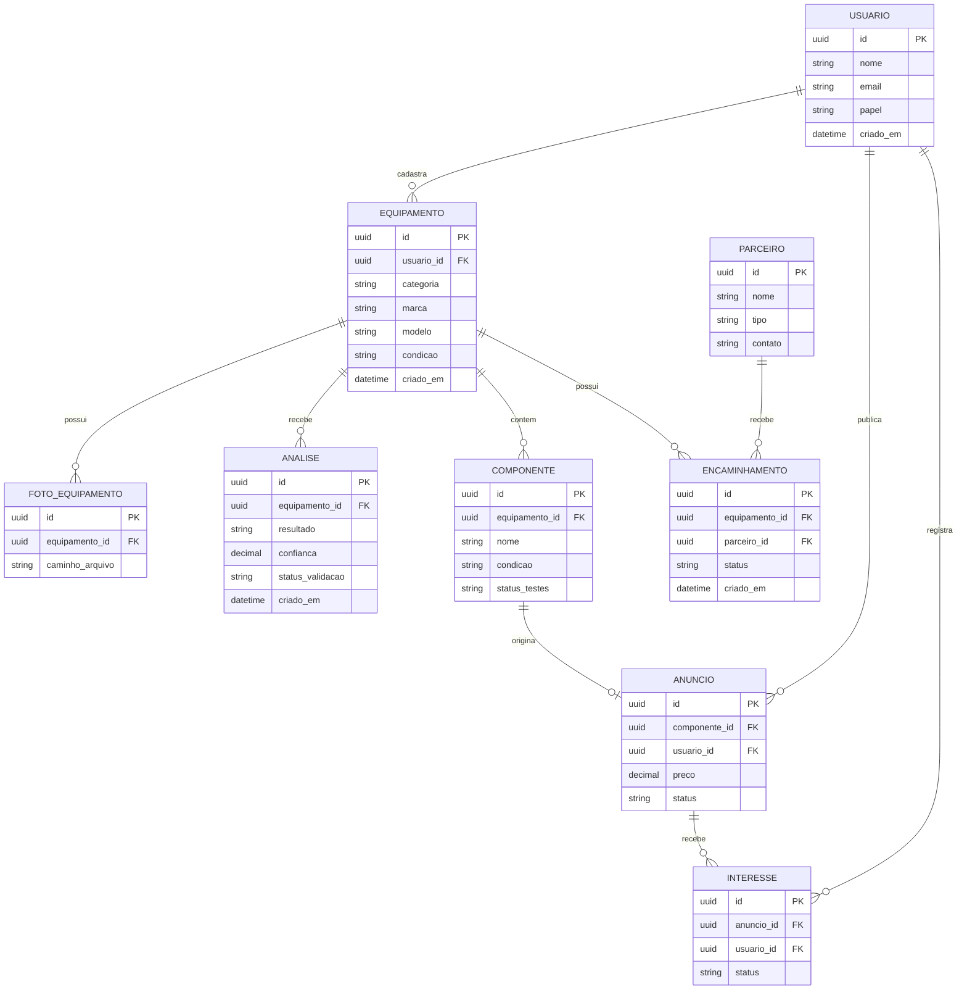
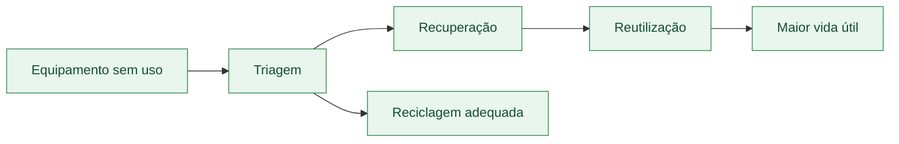

<div align="center">

# EcoCiclo

### Tecnologia que conecta reutilização, recuperação e economia circular.

**Uma plataforma para dar uma nova oportunidade a equipamentos e componentes eletrônicos.**

[](#status-do-projeto)
[](#impacto-que-buscamos)
[](#sobre-o-ecociclo)

**[Visão geral](#sobre-o-ecociclo) · [Como funciona](#como-funciona) · [Arquitetura](#arquitetura) · [Modelo de dados](#modelo-de-dados-conceitual) · [Executar localmente](#executar-localmente) · [Roadmap](#roadmap)**

</div>

---

## Sobre o EcoCiclo

Um computador que parou de funcionar nem sempre virou lixo. Muitas vezes, a memória, o armazenamento, a fonte ou outras peças ainda podem ser utilizadas em reparos e novos projetos.

O **EcoCiclo** nasce para reduzir a distância entre **quem tem equipamentos eletrônicos parados** e **quem pode aproveitar seus componentes**.

A proposta é desenvolver uma plataforma web em que pessoas e organizações possam cadastrar aparelhos, receber auxílio na identificação de peças potencialmente reaproveitáveis e conectá-las a técnicos, estudantes, oficinas, compradores e parceiros de reciclagem.

> **Nossa ideia é simples:** antes de descartar um eletrônico, descobrir o que ainda pode ter valor e garantir um destino responsável para o restante.

### O problema que queremos resolver

- **Desperdício:** equipamentos inteiros são descartados mesmo quando parte de seus componentes ainda funciona.
- **Falta de informação:** muitas pessoas não sabem o que pode ser recuperado nem como avaliar uma peça.
- **Dificuldade de conexão:** quem tem peças sobrando nem sempre encontra quem precisa delas.
- **Impacto ambiental:** o descarte inadequado de resíduos eletrônicos pode contaminar o ambiente e desperdiçar recursos.

### Nossa proposta

| Etapa | O que o EcoCiclo pretende oferecer | Valor gerado |
|:--|:--|:--|
| **Cadastrar** | Registro de equipamentos, fotos e informações sobre seu estado | Inventário de itens disponíveis |
| **Analisar** | Apoio de IA na identificação de aparelhos e possíveis componentes | Orientação inicial para triagem |
| **Recuperar** | Indicação de peças que merecem avaliação técnica | Incentivo ao reparo e reúso |
| **Conectar** | Divulgação de componentes para interessados | Circulação de peças utilizáveis |
| **Destinar** | Encaminhamento do que não pode ser aproveitado a parceiros adequados | Redução do descarte incorreto |

---

## Como funciona

O fluxo abaixo mostra o percurso do cadastro à destinação. A identificação inicial é manual no MVP. A triagem assistida por IA faz parte do roadmap.



> A avaliação técnica verifica o estado e o funcionamento das peças antes da publicação no catálogo.

---

## Funcionalidades

| Módulo | Descrição | Situação |
|:--|:--|:--:|
| **Contas e perfis** | Cadastro, recuperação de senha e perfis com papéis distintos | Implementado |
| **Inventário de eletrônicos** | Cadastro de equipamentos, fotos privadas e solicitação de avaliação | Implementado |
| **Triagem assistida por IA** | Identificação preliminar e sugestões de aproveitamento | Planejado |
| **Catálogo de componentes** | Busca, filtros, detalhes da avaliação e favoritos | Implementado |
| **Anúncios e pedidos** | Publicação de componentes aprovados, carrinho e reserva de estoque | Implementado |
| **Destinação responsável** | Encaminhamentos e confirmação com comprovante | Implementado |
| **Painel de impacto** | Indicadores agregados de recuperação e destinação | Implementado |

Os módulos que usam autenticação ou dados precisam de um projeto Supabase configurado com a migração deste repositório.

---

## Arquitetura

A interface usa Next.js, React, TypeScript e Tailwind CSS. O Supabase fornece autenticação, PostgreSQL, armazenamento privado de fotos e funções para operações como avaliação técnica e reserva de estoque.



### Princípios de implementação

1. **Mobile first:** cadastrar e fotografar equipamentos deve ser fácil pelo celular.
2. **Acessibilidade:** navegação por teclado, contraste adequado e feedback claro.
3. **Privacidade:** coletar apenas os dados necessários e protegê-los adequadamente.
4. **Rastreabilidade:** registrar a origem, a avaliação e o destino de cada item quando aplicável.
5. **IA responsável:** deixar explícito quando uma informação é estimada, sugerida ou confirmada por um profissional.
6. **Evolução modular:** começar pelo cadastro e catálogo, avançando para análises e integrações.

---

## Modelo de dados conceitual

Este diagrama ER resume o modelo conceitual do EcoCiclo. Consulte a [migração SQL](supabase/migrations/20261110235412_ecociclo_foundation.sql) para ver as tabelas, relações e políticas da implementação.



**Como ler o diagrama:** `PK` identifica a chave primária; `FK` identifica a chave estrangeira. As relações indicam, por exemplo, que um usuário pode cadastrar vários equipamentos, enquanto cada componente pertence a um equipamento.

A estrutura poderá ser ajustada conforme decisões de produto, requisitos de segurança e necessidades reais dos usuários.

---

## Exemplo ilustrativo de análise por IA

A ideia é transformar fotos e informações de um aparelho em uma **triagem compreensível**, indicando o que merece inspeção.

**Entrada:** um usuário cadastra um computador que não liga e envia imagens.

**Saída proposta** (dados fictícios, apenas para demonstrar o formato):

```json
{
  "equipamento": {
    "categoria": "computador_desktop",
    "estado_informado": "nao_liga"
  },
  "analise": {
    "status": "preliminar",
    "componentes_sugeridos": [
      {
        "nome": "memoria_ram",
        "acao": "realizar_teste_de_funcionamento"
      },
      {
        "nome": "unidade_de_armazenamento",
        "acao": "avaliar_integridade_e_apagar_dados"
      },
      {
        "nome": "fonte_de_alimentacao",
        "acao": "encaminhar_para_avaliacao_tecnica"
      }
    ],
    "observacao": "Nenhum componente foi certificado como funcional."
  }
}
```

A resposta não deve afirmar que uma peça funciona sem testes. Também é importante orientar o usuário a não abrir equipamentos com risco elétrico e a **remover dados pessoais** de dispositivos de armazenamento antes de qualquer transferência.

---

## Para quem é o EcoCiclo?

| Público | Possível benefício |
|:--|:--|
| **Moradores** | Encontrar alternativas ao descarte de eletrônicos parados |
| **Técnicos e oficinas** | Encontrar peças para manutenção e recuperação |
| **Estudantes** | Acessar componentes para aprendizado e projetos |
| **Pequenos empreendedores** | Comprar, vender ou reaproveitar peças |
| **Recicladores e parceiros** | Receber encaminhamentos de itens não recuperáveis |
| **Municípios** | Incentivar práticas de destinação adequada e economia circular |

---

## Impacto que buscamos

O EcoCiclo está alinhado à ideia de **economia circular**: manter produtos e materiais em uso pelo maior tempo possível, reduzir desperdício e melhorar o destino dos resíduos.



### Indicadores que queremos acompanhar

- **Equipamentos cadastrados** na plataforma.
- **Componentes avaliados e recuperados**, após validação.
- **Peças disponibilizadas e reaproveitadas** por outros usuários.
- **Itens encaminhados** para destinação adequada.
- **Estimativas ambientais**, futuramente, com metodologia e fontes claramente identificadas.

> Os indicadores são metas de mensuração. **Não há resultados ambientais medidos ou validados publicados neste repositório até o momento.**

---

## Roadmap

- [x] **Fase 1 · Fundação:** definir experiência do usuário, identidade visual e estrutura inicial do sistema.
- [x] **Fase 2 · Cadastro:** autenticação, perfis e registro de equipamentos com fotografias.
- [x] **Fase 3 · Catálogo:** cadastro de componentes, filtros e anúncios.
- [ ] **Fase 4 · Inteligência:** implementar triagem assistida com validação técnica.
- [ ] **Fase 5 · Conexões:** facilitar contato entre interessados e parceiros.
- [x] **Fase 6 · Impacto:** criar painel com métricas de reaproveitamento e destinação.
- [ ] **Fase 7 · Evolução:** testar com usuários, aprimorar acessibilidade, segurança e desempenho.

A ordem pode mudar conforme a validação do projeto e as prioridades de desenvolvimento.

---

## Status do projeto

O MVP inclui cadastro de eletrônicos com fotos, avaliação técnica, catálogo, pedidos com reserva de estoque e encaminhamento para destinação. A análise por IA e a cobrança online seguem pendentes.

## Executar localmente

Use Node.js 22 ou superior e npm. Copie `.env.example` para `.env.local` e preencha `NEXT_PUBLIC_SUPABASE_URL` e `NEXT_PUBLIC_SUPABASE_PUBLISHABLE_KEY` com a URL e a chave publicável do seu projeto Supabase.

```sh
npm ci
npm run dev
```

Abra `http://localhost:3000`. A entrada do EcoCiclo exige uma sessão com e-mail verificado. Termos e privacidade podem ser consultados antes do cadastro.

### Autenticação e administração

1. Aplique as [migrações do EcoCiclo](supabase/migrations/) em ordem no projeto Supabase.
2. Nas configurações do Supabase Auth, use o domínio de produção como **Site URL** e autorize os redirecionamentos completos para `/conta/` em produção e desenvolvimento. Mantenha a confirmação por e-mail habilitada e configure SMTP para receber cadastros externos. Os links de confirmação e recuperação usam PKCE e devem ser abertos no navegador em que foram solicitados.
3. O proprietário do banco deve conceder o papel inicial `admin` a uma conta identificada e com e-mail confirmado. Novas contas recebem somente o papel `user`. A partir do primeiro administrador, use **Administração → Pessoas e permissões** para gerenciar os papéis.

| Papel | Acesso |
| --- | --- |
| Usuário | Equipamentos e pedidos próprios, catálogo e acompanhamento de destinação |
| Técnico | Avaliação de equipamentos enviados à equipe técnica |
| Parceiro | Encaminhamentos atribuídos à sua organização ativa |
| Administrador | Permissões, avaliações, catálogo, denúncias, parceiros e auditoria |

```sh
npm run typecheck
npm test
npm run build
```

O build exporta o site estático para `out/`. Na Vercel, configure as mesmas variáveis públicas no ambiente de build. O [registro de implementação](docs/IMPLEMENTATION.md) detalha os testes e as decisões do projeto.

### Como colaborar

Ideias sobre reaproveitamento, experiência de uso, acessibilidade, triagem e destinação de resíduos são bem-vindas. Você pode propor melhorias por meio das [issues do repositório](https://github.com/piririporo/EcoCiclo/issues), quando habilitadas.

---

<div align="center">

### EcoCiclo

**Menos descarte. Mais possibilidades.**

*Porque o fim de um equipamento não precisa ser o fim de todos os seus componentes.*

[Voltar ao início](#ecociclo)

</div>
